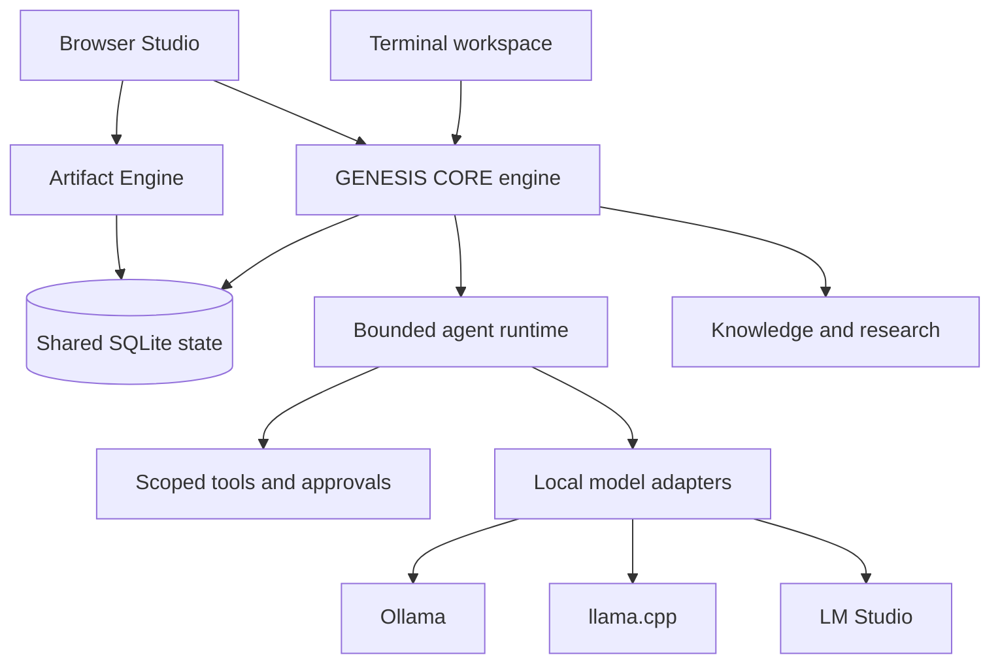

# GENESIS CORE


<p align="center">
  <a href="https://github.com/testjust019-xd/GENESIS-CORE/actions/workflows/ci.yml"></a>
  <a href="LICENSE"></a>
  
  
</p>

**An open-source, local-first AI agent and evolution framework. One engine, two interfaces: terminal and browser.**

GENESIS CORE is its own agent environment. Ollama, llama.cpp and LM Studio are interchangeable inference backends; they do not provide GENESIS's orchestration, memory, tools, workflows or Studio interface.

> GENESIS does not magically increase a model's parameter count or native abilities. It helps a model accomplish more through verified knowledge, structured workflows, scoped tools and evidence-based feedback. Actual weight changes require a separate training process.

## What is GENESIS?

- **Terminal workspace:** an interactive TUI and command-line setup.
- **Browser Studio:** chat, missions, memory, skills, system status and artifact workspace.
- **Artifact Engine:** create, edit, preview and save small HTML/CSS/JavaScript experiences locally.
- **Agent runtime:** bounded planning, tool use, task execution and observation.
- **Persistent context:** shared SQLite state for sessions, memories, missions and artifacts.
- **Knowledge and research:** local document retrieval plus optional web search providers.
- **Evidence-guided evolution:** review experience and evaluation evidence before promoting reusable lessons.
- **Resource-aware setup:** inspect hardware and discover supported local model runtimes.

## Project status

**Early foundation · v0.1.0-dev.** GENESIS is actively evolving. Core workflows have automated tests, but hardware-specific inference speed, model quality and long-running behavior still need real-world testing on each target machine. It is not presented as a finished autonomous system.

## Quick start

**Linux · Python 3.11+ · Git**

```bash
git clone https://github.com/testjust019-xd/GENESIS-CORE.git
cd GENESIS-CORE

python3 -m venv .venv
source .venv/bin/activate

python -m pip install --upgrade pip
python -m pip install -e ".[web,dev]"

genesis test
genesis init
genesis studio
```

Open **http://127.0.0.1:8765** in a browser on the same machine.

The commands above install GENESIS and launch Studio without requiring a model. To use AI chat or agent execution, connect a supported local model runtime and select a model in the next section.

For the complete Ubuntu/Debian walkthrough, optional dependencies, troubleshooting and update steps, see **[Installation Guide](docs/INSTALLATION.md)**.

## Connect a local model

GENESIS can discover local Ollama, llama.cpp and LM Studio endpoints.

```bash
genesis models
genesis recommend
genesis setup
```

If a model is already installed and loaded, select the exact provider and model identifier shown by `genesis models`:

```bash
genesis model set ollama gemma3:1b
genesis model show
```

The model identifier above is an example, not a required download. Choose a model that fits the machine's available memory and performance. GENESIS does not silently install a model runtime or download model weights.

## GENESIS Studio and Artifact Engine

Start the browser workspace:

```bash
genesis studio
```

Then open **http://127.0.0.1:8765** and select **Artifacts** in the navigation.

The Artifact Engine currently provides:

- A focused HTML editor for self-contained prototypes.
- Debounced live preview as you edit, plus a manual refresh shortcut.
- Sandboxed preview isolation without same-origin privileges.
- A restrictive Content Security Policy that blocks network requests and external resources.
- A local artifact library with create, reopen, update and delete.
- SQLite persistence shared with the rest of GENESIS.
- A 200 KB UTF-8 source limit per artifact.

Keyboard shortcuts in the editor:

| Shortcut | Action |
| --- | --- |
| Ctrl/⌘ + Enter | Refresh preview |
| Ctrl/⌘ + S | Save artifact |

Artifacts are saved locally; they are not automatically published as public websites. Inline JavaScript is allowed inside the sandbox for interactive prototypes. Only preview code you understand.

Read the [Artifact Engine guide](docs/ARTIFACT_ENGINE.md).

## Terminal commands

```bash
genesis --help
genesis welcome
genesis doctor
genesis models
genesis recommend
genesis setup
genesis test
genesis init
genesis tui
genesis studio
```

Search provider configuration:

```bash
genesis search show
genesis search set offline
genesis search set searxng --url http://127.0.0.1:8080
```

Runtime endpoints can be overridden with `GENESIS_OLLAMA_URL`, `GENESIS_LLAMA_CPP_URL` and `GENESIS_LM_STUDIO_URL`. Search settings support `GENESIS_SEARCH_PROVIDER` and `GENESIS_SEARXNG_URL`.

## Architecture

TUI and Studio are clients of the same Python engine and local state. Optional inference and search services plug into that engine; they are not required for offline storage or diagnostics.



## Data, privacy and safety

- Default user data directory: `~/.genesis`.
- Default SQLite database: `~/.genesis/data/genesis.db`.
- Set `GENESIS_HOME` before launch to use a different data directory.
- Studio binds to `127.0.0.1` by default and should remain local unless you add your own access controls.
- Only registered tools are available to the agent. Elevated actions require approval.
- Unreviewed research sources are treated as untrusted evidence.
- Skills are declarative instructions, not arbitrary executable plugins.
- Learning XP and experience records do not modify model weights or prove intelligence.

## Tests and real-world checks

Run the default offline Test Bench:

```bash
genesis test
```

It uses temporary databases, makes no network requests, downloads nothing and does not modify your normal GENESIS database. To also probe local model-list endpoints:

```bash
genesis test --full
```

CI uses mock providers. After CI passes, connect a real local model and follow the [real-world verification checklist](docs/REAL_WORLD_TEST.md) to test inference, streaming, persistence, permissions and resource use on your machine.

## Documentation

| Guide | What it covers |
| --- | --- |
| [Installation](docs/INSTALLATION.md) | Full install, setup, launch, update and troubleshooting |
| [First launch](docs/FIRST_LAUNCH.md) | Hardware detection and model setup |
| [Artifact Engine](docs/ARTIFACT_ENGINE.md) | Local web artifacts and sandboxed preview |
| [Test Bench](docs/TEST_BENCH.md) | Offline diagnostics and self-tests |
| [Real-world verification](docs/REAL_WORLD_TEST.md) | Checklist for a real model and target hardware |
| [Research with SearXNG](docs/SEARXNG.md) | Optional web search provider |
| [Interfaces](docs/INTERFACES.md) | Terminal and browser interface design |
| [Experience Engine](docs/EXPERIENCE_ENGINE.md) | Recorded outcomes and provenance |
| [Evidence-guided evolution](docs/EVIDENCE_GUIDED_EVOLUTION.md) | Reviewable lessons from experience evidence |
| [Roadmap](ROADMAP.md) | Current milestones and planned work |

## Contributing

Issues and pull requests are welcome. For substantial changes, describe the intended behavior, constraints and tests. Keep optional services optional, preserve local-first behavior and document any new permissions or network access.

## License

MIT — see [LICENSE](LICENSE).
